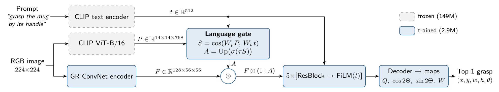
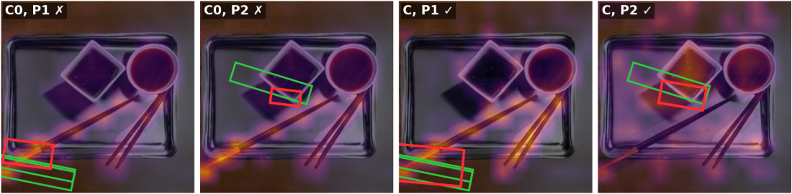

<div align="center">

# Language-Gated GR-ConvNet

**Steering a compact grasp CNN with frozen CLIP patch–text similarity**

Minh-Ngoc Luong · Hanoi University of Science and Technology

[](paper/language_gated_grasp.pdf)
[](LICENSE)
[](requirements.txt)
[-informational)](tests/test_offline.py)

[Results](#results) · [Method](#method) · [Evaluation](#evaluation-protocol) · [Reproducing](#reproducing) · [Repository layout](#repository-layout) · [Citation](#citation)

</div>

Short paper for the FPT Frontier Innovators 2026 (QACI) assignment on language-driven grasp detection: given an RGB image and a prompt such as *"grasp the mug by its handle"*, predict one grasp rectangle on the named part of the object (Grasp-Anything++).

> **TL;DR.** A spatial *language gate*, the cosine similarity between projected frozen CLIP ViT-B/16 patch tokens and the prompt embedding, re-weights the features of a FiLM-conditioned GR-ConvNet. On the annotated pairs of the official LGD test split (two-seed mean):
>
> * seen / unseen success rises from **54.8% / 40.7%** (FiLM only) to **68.6% / 57.7%**, and *H* from 46.7 to **62.7**;
> * a control gate with the same CLIP features but no access to the prompt (C0) is 11.6 / 11.8 unseen points lower in the two seeds (paired McNemar *p* < 1e-3 in all four seed × split comparisons), so **9.4 of the 16.0 *H* points come from reading the prompt**;
> * cost over FiLM only: +0.33M trained parameters and the frozen CLIP image encoder; 19.7 ms per frame end-to-end on a T4 (13.0 ms with a cached prompt).

<p align="center">
  
</p>
<p align="center"><sub><b>Architecture.</b> The prompt enters through the spatial gate <i>A</i> and through FiLM after every residual block. Grey dashed: frozen CLIP (149M parameters). Blue: trained (2.9M parameters). Source: <a href="docs/architecture.tex"><code>docs/architecture.tex</code></a>.</sub></p>

## Results

Test success (%) on the official LGD split of Grasp-Anything++ (1,376 seen, 601 unseen prompt–grasp pairs). B, C0 and C: mean ± half-range over seeds 0 and 1; A and D: seed 0 only. Latency: end-to-end, batch 1, fp16, one T4, including the CLIP text and image encoders, excluding JPEG decoding.

| Run | Model | Trainable params | Seen | Unseen | H | Latency (ms) |
|:--|:--|--:|--:|--:|--:|--:|
| A | GR-ConvNet, RGB only, no text | 1.90M | 27.3 | 27.8 | 27.5 | 4.7 |
| B | A + FiLM(t) | 2.55M | 54.8±2.7 | 40.7±0.6 | 46.7±1.4 | 14.1 |
| C0 | B + text-free CLIP gate (control; code name `E`) | 2.75M | 63.3±0.5 | 46.0±1.9 | 53.3±1.1 | 19.6 |
| **C** | **B + language gate (proposed)** | 2.88M | 68.6±0.4 | 57.7±1.8 | 62.7±1.3 | 19.7 |
| D | C + gate supervision | 2.88M | 70.8 | 57.7 | 63.6 | 21.5 |

Success: the top-1 grasp has IoU > 0.25 and angle error < 30° with some ground-truth grasp of the prompted part. *H*: harmonic mean of seen and unseen success. Numbers use the plateau decoder (see [Decoding](#decoding)); the original argmax numbers are in [`results/summary.csv`](results/summary.csv) and differ by at most 0.2 points. All runs: 6 epochs on 35,927 scenes (183,559 prompt–grasp pairs), one Kaggle T4 per run, 2.5–2.7 h.

**What the controls show** (paired tests: [`results/mcnemar.csv`](results/mcnemar.csv))

* **B → C0 (+6.6 H):** frozen CLIP patch features behind a gate that cannot read the prompt. The unseen gain varies between seeds: +7.8 points in seed 0 (McNemar p < 1e-3), +2.8 in seed 1 (p = 0.21).
* **C0 → C (+9.4 H):** letting the gate read the prompt. Seed for seed, C exceeds C0 by 11.6 / 11.8 unseen and 6.3 / 4.4 seen points; McNemar p < 1e-3 in all four comparisons, and 95% bootstrap intervals that resample whole scenes exclude zero.
* **Share of the B → C gain from prompt-dependent gating:** 69% unseen, 59% *H*, 38% seen.
* **D:** gate supervision does not differ significantly from C of the same seed (p = 0.06 seen, 0.28 unseen), so the simpler C is kept.
* **Latency with a cached prompt** (the prompt rarely changes between frames): C takes 13.0 ms per frame (6.4 ms network + 6.6 ms CLIP image encoder).

<p align="center">
  
</p>
<p align="center"><sub><b>Gate maps</b> (heat), top-1 grasp (red), ground truth (green) for P1 "Hold chopsticks at its pair of sticks" and P2 "Take hold of bottle on its container" (unseen, seed 0). The C0 gate ignores the prompt; the C gate follows it.</sub></p>

**Gate maps.** In the 118 test scenes with more than one annotated object, C is correct for two prompts on different objects in 55 scenes (seed 0) and 49 (seed 1), C0 in 40 and 41 (from the committed predictions; [`results/gate_stats.json`](results/gate_stats.json) reports 54 because the gate-map pass re-runs the model in fp32 instead of fp16). The C0 gate is identical for every prompt (mean absolute change 0.0); the C gate changes by 0.09 on average.

> [!IMPORTANT]
> These numbers are **not comparable** to the LGD paper (seen 48 / unseen 42; 18 unseen for GR-ConvNet + CLIP). Training here uses 35,927 of the ~1M images (≈3.6%) and testing covers only the annotated test pairs; the prompt-blind model A already exceeds the reported GR-ConvNet + CLIP unseen score, which indicates a different protocol.

**Check the table in seconds** (CPU, pandas only, from the committed per-pair predictions):

```bash
python - <<'EOF'
import pandas as pd
def acc(run, split):
    path = f'results/runs/plateau/{run}/test_{split}_predictions.csv'
    return 100 * pd.read_csv(path).success.mean()
groups = {'A': ['A'], 'B': ['B', 'B_s1'], 'C0': ['E', 'E_s1'],
          'C': ['C', 'C_s1'], 'D': ['D']}
for name, runs in groups.items():
    s = [acc(r, 'seen') for r in runs]
    u = [acc(r, 'unseen') for r in runs]
    h = [2 * a * b / (a + b) for a, b in zip(s, u)]
    mean = lambda v: sum(v) / len(v)
    print(f'{name:3s} seen {mean(s):5.1f}  unseen {mean(u):5.1f}  H {mean(h):5.1f}')
EOF
```

Expected output: the Seen / Unseen / H columns of the table (H is the mean of the per-seed H).

## Method

Given an RGB image and a prompt such as *"grasp the mug by its handle"*, the model predicts one grasp rectangle (x, y, w, h, θ) on the part of the object that the prompt names. The base network is [GR-ConvNet](https://arxiv.org/abs/1909.04810). It predicts four dense maps (quality *Q*, cos 2Θ, sin 2Θ, opening *W*) and reads the grasp at the peak of the smoothed *Q* map (most interior pixel of the near-maximum plateau; see [Decoding](#decoding)). The height is fixed to h = w/2, the GR-ConvNet convention. The prompt embedding *t* (frozen CLIP text encoder) enters the network in two places:

* **FiLM** after each of the 5 residual blocks *k*. The FiLM layers are zero-initialised, so training starts from the vision-only network.

```math
F \leftarrow \big(1 + \Delta\gamma_k(t)\big) \odot F + \beta_k(t)
```

* **Language gate (proposed).** *P* are the 14×14 patch tokens of a frozen CLIP ViT-B/16; *W_p*, *W_t* are learned projections and τ a learned scale.

```math
S = \cos(W_p P,\ W_t t), \qquad A = \mathrm{Up}\big(\sigma(\tau S)\big), \qquad F' = F \odot (1 + A)
```

* **Control C0** (code name `E`): replaces *W_t t* with a learned, prompt-independent vector *q*. C0 sees the same CLIP features but cannot read the prompt in its gate (FiLM still receives *t*).

## Evaluation protocol

* **Test set.** The official LGD split files (`split/grasp-anything++/test/{seen,unseen}.obj`) are used: 573 seen and 230 unseen object keys. The files are parsed with a regex and never unpickled. This gives 1,376 seen and 601 unseen prompt–grasp pairs that have both a prompt and a label file.
* **Metric.** [`src/eval_utils.py`](src/eval_utils.py) is this project's implementation of the LGD criterion (rotated-rectangle IoU with Shapely, angle difference taken mod π), written in notebook 01. Sanity checks (also in [`tests/test_offline.py`](tests/test_offline.py)): ground truth as prediction scores 1.0; +29° passes, +31° fails; +180° passes.
* **Upper bound of the map representation.** Decoding the ground-truth target maps of 200 validation pairs scores 98.0% (97.5% with plain argmax).
* **Leakage control.** Test scenes and training pairs with an unseen test object name are removed from training (details below).

<details>
<summary><b>Leakage control (details)</b></summary>

* All 620 test scenes of the official split are removed from training (count from notebook 01).
* Every training pair whose object name appears among the unseen test objects is also removed. This is done after name normalisation.
* Validation uses 2% of the training scenes (seed 0). Checkpoints are selected on a fixed 1,000-pair subset of it.
* After filtering, training keeps 35,927 scenes and 183,559 pairs. 40 of the 41 seen test object names (1,373 of 1,376 seen pairs) occur in training, with a median of 3,723 training pairs per name.
* The filter parses the object name from each prompt (`prepare.normalize_name`). As an independent check, `extras.py` also searches the raw training prompts for every unseen name (word boundaries, plural forms). It finds 3 names in 5,332 prompts, all as parts of other objects ("spoon at its bowl-shaped", "wine on its bottle", "candlestick at its candle holder"); none occurs in a parsed object name. Record: [`results/coverage.json`](results/coverage.json).

</details>

<a id="decoding"></a>
<details>
<summary><b>Decoding: plateau vs. argmax</b></summary>

The ground-truth *Q* target is a flat block, so its smoothed maximum is a plateau. A plain `argmax` returns the first (top-left) pixel of that plateau, which can lie far from the rectangle centre; [`tests/test_offline.py`](tests/test_offline.py) checks that the plateau decoder recovers the centre of synthetic rectangles (median offset below 3 px). The decoder therefore picks the most interior pixel of the near-maximum set (`infer.select_peak`); for a unique maximum this equals `argmax`.

All checkpoints were re-evaluated with [`src/reeval.py`](src/reeval.py) under both decoders ([`results/reeval_summary.csv`](results/reeval_summary.csv)):

* `decode='argmax'` reproduces the original per-pair success of all 8 runs exactly (82 of the 15,816 predicted centres move by more than 0.5 px because of fp16 ties, without changing any outcome; compare `results/runs/argmax/` with `results/runs/<run>/`);
* the plateau decoder changes each model's success by at most 0.2 points;
* it raises the ground-truth-map decoding ceiling from 97.5% to 98.0% (200 validation pairs).

The results table uses the plateau decoder; [`results/summary.csv`](results/summary.csv) keeps the original argmax numbers.

</details>

## Reproducing

**Requirements.** Python with the packages in [`requirements.txt`](requirements.txt) (`pip install -r requirements.txt`). Model checkpoints (`*.pt`) are not committed; the committed per-pair predictions in `results/runs/` are enough to check every number in the results table.

**0. Offline checks** (CPU, no data, a few seconds): `python -m pytest tests -q` (shapes, FiLM identity at initialisation, trainable-parameter counts, metric sanity checks).

**1. Build the data** with [`notebooks/01_build_eval_data.ipynb`](notebooks/01_build_eval_data.ipynb) on Kaggle (CPU, Internet on).

* It downloads the official test-split keys from the [LGD repository](https://github.com/Fsoft-AIC/LGD).
* It streams a ~3 GB image prefix plus the annotation archives from the public Hugging Face dataset [`airvlab/Grasp-Anything-pp`](https://huggingface.co/datasets/airvlab/Grasp-Anything-pp).
* It writes packed files (`images.bin`, `labels.npy`, parquet indexes) and the train/val/test manifests.
* Save the output as a Kaggle dataset (here `ga-pp-packed`).

**2. Train and evaluate** with [`notebooks/02_train_evaluate.ipynb`](notebooks/02_train_evaluate.ipynb) (Kaggle, **GPU T4 ×2**, packed dataset attached).

* Choose the runs in cell 3, e.g. `VARIANTS=['A','B']`, `['C','D']`, `['E','C_s1']` or `['B_s1','E_s1']`.
* Each pair of runs trains in parallel, one per GPU, in about 3 h. Results are written to `/kaggle/working/results/`.
* The notebook is the as-run snapshot (see its first cell): it decodes with `argmax` and therefore reproduces [`results/summary.csv`](results/summary.csv). Run `src/reeval.py` on its checkpoints to obtain the plateau-decoded numbers of the results table.
* Training is not bit-reproducible: cuDNN autotuning is enabled for speed, so reruns differ slightly.

<details>
<summary><b>2′. Run the scripts directly instead of the notebook</b></summary>

Requirements: two CUDA GPUs (the CLIP patch-token cache for C/D/E is built on both), at least 25 GB free under `/tmp` (the patch tokens take about 14 GB), and Internet access for the CLIP weights. Defaults write runs to `/kaggle/working/runs`; pass `--base` and `--destination` elsewhere.

```bash
cd src
python prepare.py --root /path/to/ga_eval --variants C E
python tests.py --device cuda:0
python launch.py --variants C E --max-hours 3.5 --base runs
python summarize.py --variants C E --base runs --destination results
python latency_e2e.py --gpu 0 --out results
python reeval.py --data-root /path/to/ga_eval --runs-dir . --out reeval      # finds results/<run>/best.pt below --runs-dir
python extras.py --skip-gpu --data-root /path/to/ga_eval --runs-dir reeval/plateau --out reeval/extras
# the gate-map part of extras.py (without --skip-gpu) currently looks for checkpoints under /kaggle/input
```

</details>

**3. Recompute the analyses** (McNemar tests, scene bootstrap, name coverage, leakage search) from the committed predictions, without a GPU; `<ga_eval>` holds the test manifests from notebook 01:

```bash
python src/extras.py --skip-gpu --data-root <ga_eval> --runs-dir results/runs/plateau --out /tmp/extras
```

## Repository layout

```text
.
├── notebooks/
│   ├── 01_build_eval_data.ipynb   Kaggle CPU: official test split + training subset → packed dataset
│   └── 02_train_evaluate.ipynb    Kaggle 2×T4: caches, two runs in parallel, evaluation, latency (as-run)
├── src/
│   ├── config.py                  experiment defaults (batch, lr, epochs, decoder, …)
│   ├── common.py                  logging, JSON I/O, seeding, disk checks
│   ├── prepare.py                 packed data → 224×224 image cache, CLIP text / patch-token caches
│   ├── data.py                    dataset and GR-ConvNet target maps
│   ├── model.py                   GraspNet variants A, B, C, D, E (= C0)
│   ├── infer.py                   smoothing and top-1 decoding (plateau; decode='argmax' = original)
│   ├── train.py                   AdamW + cosine, fp16, checkpoint selection, final evaluation
│   ├── evaluate.py                success metric over a split, latency, qualitative figure
│   ├── eval_utils.py              rotated-rectangle IoU + angle criterion (from notebook 01)
│   ├── packed_io.py               reader for the packed image / label files
│   ├── tests.py                   GPU pre-training checks (shapes, FiLM identity, target round trip)
│   ├── launch.py                  two-GPU launcher with watchdog (run specs such as A, E, C_s1)
│   ├── summarize.py               collects per-run outputs and writes summary.csv
│   ├── latency_e2e.py             batch-1 end-to-end latency incl. CLIP encoders
│   ├── reeval.py                  re-evaluates checkpoints with both decoders + GT-map ceiling
│   ├── extras.py                  McNemar, scene bootstrap, name coverage, leakage search, gate maps
│   ├── make_gate_figure.py        gate-map figure from extras.py output
│   └── collect_artifacts.py       copies small per-run files from attached Kaggle outputs
├── tests/test_offline.py          CPU-only checks (python -m pytest tests -q)
├── results/                       tables, per-run outputs and analyses (see "Result files" below)
├── docs/                          architecture figure and its TikZ source
└── paper/                         LaTeX source (CVPR 2026 author kit) and PDF of the 2-page paper
```

Run names: `A`, `B`, `C`, `D`, `E` are seed 0; the suffix `_s1` marks seed 1. `E` is the control C0.

<details>
<summary><b>Result files (<code>results/</code>)</b></summary>

| File | Content | Produced by |
|:--|:--|:--|
| `reeval_summary.csv` | test success of every checkpoint with both decoders | `src/reeval.py` |
| `runs/<run>/` | original outputs of each run: `metrics.json`, `config.json`, per-pair test predictions, and `train_log.csv` (every 100th training step plus all validation rows; not kept for E and C_s1) | `src/train.py` |
| `runs/plateau/<run>/`, `runs/argmax/<run>/` | per-pair test predictions of the same checkpoints re-evaluated with the plateau and the argmax decoder | `src/reeval.py` |
| `runs/*.json`, `runs/target_roundtrip.csv` | data-preparation record (leakage filter, caches) and the ground-truth-map decoding check | `src/prepare.py`, `src/tests.py` |
| `target_roundtrip_both_decoders.json` | ground-truth-map decoding ceiling with both decoders | `src/reeval.py` |
| `mcnemar.csv` | paired McNemar tests and scene-clustered bootstrap intervals (plateau decoder) | `src/extras.py` |
| `coverage.json`, `coverage_success.csv` | training coverage of test object names, independent leakage search, success on single- vs multi-object scenes | `src/extras.py` |
| `gate_stats.json` | gate-map statistics on the 118 multi-object test scenes | `src/extras.py` |
| `fixed_val_curves.csv` | per-epoch success on the fixed 1,000-pair validation subset | `src/extras.py` (from `train_log.csv`) |
| `latency_e2e.csv`, `latency_e2e.json` | latency per stage (plateau decoder) | `src/latency_e2e.py` |
| `summary.csv` | one row per run with the original (argmax-decoded) test numbers; `val` is full-validation success at the selected checkpoint, `kaggle_version` the Kaggle notebook version that trained the run, `wall_hours` the training wall time | collected by hand from `runs/<run>/metrics.json` |

</details>

## Citation

```bibtex
@misc{luong2026languagegated,
  title        = {Language-Gated {GR-ConvNet}: Steering a Compact Grasp {CNN} with Frozen {CLIP} Patch--Text Similarity},
  author       = {Luong, Minh-Ngoc},
  year         = {2026},
  note         = {Short paper, FPT Frontier Innovators 2026 (QACI) assignment},
  howpublished = {\url{https://github.com/Ngoc-LM/language-gated-grasp}}
}
```

## Acknowledgements

* Grasp maps and decoding follow [GR-ConvNet](https://arxiv.org/abs/1909.04810) (Kumra et al., IROS 2020).
* Dataset, split and baselines come from Grasp-Anything++ / [LGD](https://github.com/Fsoft-AIC/LGD) (Vuong et al., CVPR 2024).
* Text and patch features come from OpenAI CLIP ViT-B/16 (`openai/clip-vit-base-patch16`) via Hugging Face `transformers`.

Code released under the [MIT License](LICENSE). Contact: Minh-Ngoc Luong, ngoclm004@gmail.com.
