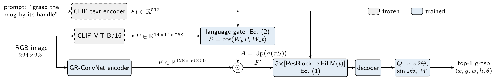

# Language-Gated GR-ConvNet

**Steering a compact grasp CNN with frozen CLIP patch–text similarity**
Minh-Ngoc Luong. Short paper for the FPT Frontier Innovators 2026 (QACI) assignment on language-driven grasp detection, Grasp-Anything++.



Given an RGB image and a prompt such as *"grasp the mug by its handle"*, the model predicts one grasp rectangle `(x, y, w, h, θ)` on the part of the object that the prompt names. The base network is [GR-ConvNet](https://arxiv.org/abs/1909.04810), which predicts four dense maps (quality `Q`, `cos 2Θ`, `sin 2Θ`, opening `W`) and reads the grasp at `argmax Q`. The prompt enters the network in two places:

* **FiLM** after each of the 5 residual blocks: `F ← (1 + Δγ_k(t)) ⊙ F + β_k(t)`. The FiLM layers are zero-initialised, so training starts from the vision-only network.
* **Language gate (proposed)**: `S = cos(W_p P, W_t t)`, `A = Up(σ(τ S))`, `F' = F ⊙ (1 + A)`. Here `P` are the 14×14 frozen CLIP ViT-B/16 patch tokens and `t` is the frozen CLIP text embedding.

There is also a control variant, **C0**. It replaces `W_t t` with a learned, prompt-independent vector `q`. C0 therefore sees the same CLIP features but cannot read the prompt.

## Results (official LGD test split of Grasp-Anything++)

All runs train for 6 epochs on 35,927 scenes (183,559 prompt–grasp pairs), one Kaggle T4 per run (2.5–2.7 h).

Success is the top-1 grasp with IoU > 0.25 and angle error < 30°. `H` is the harmonic mean of seen and unseen success. Latency is end-to-end, batch 1, fp16 on a T4, and includes the frozen CLIP encoders. B, C0 and C are the mean ± half-range of seeds 0 and 1; A and D use seed 0 only.

| run | model | seen | unseen | H | latency |
|---|---|---|---|---|---|
| A | GR-ConvNet, vision only | 27.3 | 27.8 | 27.5 | 4.3 ms |
| B | + FiLM(t) | 54.7 ± 2.7 | 40.7 ± 0.6 | 46.7 ± 1.4 | 12.3 ms |
| C0 (`E`) | B + text-free CLIP gate | 63.3 ± 0.5 | 46.0 ± 1.9 | 53.3 ± 1.1 | 18.2 ms |
| **C** | **B + language gate (proposed)** | **68.6 ± 0.5** | **57.8 ± 1.9** | **62.8 ± 1.3** | 18.9 ms |
| D | C + gate supervision | 70.9 | 57.7 | 63.6 | 18.8 ms |

* **B → C0 (+6.6 H):** gain from frozen CLIP patch features behind a gate that cannot read the prompt. In seed 1 this gain is significant on seen objects (+6.4, McNemar p < 1e-6) but not on unseen objects (+2.8, p = 0.21).
* **C0 → C (+9.5 H):** gain from letting the gate read the prompt. Within each seed, C exceeds C0 by 11.8 unseen points and by 6.3 / 4.4 seen points. Paired McNemar tests on the same test pairs give p < 1e-3 in all four comparisons (2 seeds × seen/unseen), and 95% bootstrap intervals that resample whole scenes exclude zero (unseen: [6.6, 17.5] and [5.9, 17.4] points).
* **Share of the B → C gain due to prompt-dependent gating:** 69% unseen, 59% H, 38% seen.
* **D:** gate supervision does not differ significantly from C of the same seed (p = 0.06 seen, 0.24 unseen), so the simpler C is kept.
* **Gate maps.** In the 118 test scenes with more than one annotated object, C (seed 0) is correct for two prompts on different objects in 54 scenes and C0 in 40. The paper's Fig. 2 shows the gate of both models for two prompts on one such scene.

The numbers are **not comparable** to the LGD paper (seen 48 / unseen 42; 18 unseen for GR-ConvNet + CLIP). Training here uses 3.6% of the images and testing covers only the annotated test pairs; the prompt-blind model A already exceeds the reported GR-ConvNet + CLIP unseen score, which indicates a different protocol.

Result files in [`results/`](results):

* `summary.csv`: per-run metrics (both seeds); `fixed_val_curves.csv`: per-epoch success on the fixed 1,000-pair validation subset; `latency_e2e.csv`: latency.
* `mcnemar.csv`: paired McNemar tests and scene-clustered bootstrap intervals; `coverage.json`, `coverage_success.csv`: training coverage of test object names, and success split into single- and multi-object scenes.
* All analysis files are produced by [`src/extras.py`](src/extras.py) from the saved per-pair predictions and checkpoints, without retraining; [`src/make_gate_figure.py`](src/make_gate_figure.py) renders the gate-map figure.

## Evaluation protocol

* **Test set.** The official LGD split files (`split/grasp-anything++/test/{seen,unseen}.obj`) are used: 573 seen and 230 unseen object keys. The files are parsed with a regex and never unpickled. This gives 1,376 seen and 601 unseen prompt–grasp pairs that have both a prompt and a label file.
* **Leakage control.**
  * All 620 test scenes are removed from training.
  * Every training pair whose object name appears among the unseen test objects is also removed. This is done after name normalisation.
  * Validation uses 2% of the training scenes (seed 0). Checkpoints are selected on a fixed 1,000-pair subset of it.
  * After filtering, training keeps 35,927 scenes and 183,559 pairs. 40 of the 41 seen test object names (1,373 of 1,376 seen pairs) occur in training, with a median of 3,723 training pairs per name; no unseen name does.
* **Metric.** The metric code is [`src/eval_utils.py`](src/eval_utils.py) (rotated-rectangle IoU with Shapely, angle difference taken mod π). It passed sanity checks: ground truth used as the prediction scores 1.0; a +31° rotation fails; a +180° rotation succeeds.
* **Upper bound of the map representation.** Decoding the ground-truth target maps scores 97.5% on validation.

## Repository layout

```
notebooks/01_build_eval_data.ipynb   Kaggle CPU: official test split + training subset -> packed dataset
notebooks/02_train_evaluate.ipynb    Kaggle GPU T4 x2: writes src/, prepares caches, trains two runs in parallel,
                                     evaluates, measures latency (self-contained copy of src/)
src/
  prepare.py      copy packed data, decode 224x224 image cache, CLIP text embeddings, CLIP patch tokens (C/D/E)
  data.py         dataset + GR-ConvNet-style target maps
  model.py        GraspNet: variants A (vision), B (+FiLM), C (+language gate), D (+gate loss), E (= C0, text-free gate)
  train.py        AdamW + cosine, fp16, best checkpoint on fixed validation subset, final val/test evaluation
  evaluate.py     top-1 decoding + success metric, latency, qualitative figure
  infer.py        Gaussian smoothing and argmax decoding
  tests.py        shape / FiLM-identity checks and target round-trip (must reach >= 80%)
  launch.py       two-GPU launcher with hard watchdog; run specs like  A  E  C_s1 (variant C, seed 1)
  latency_e2e.py  batch-1 end-to-end latency incl. CLIP text / vision encoders
  extras.py       post-hoc analyses: McNemar tests, scene bootstrap, name coverage, gate maps
  make_gate_figure.py  gate-map figure from extras.py output
  eval_utils.py   success metric (shared verbatim with the data notebook)
  packed_io.py    reader for the packed image/label files
results/          summary tables, validation curves, latency, figures
paper/            LaTeX source (CVPR 2026 author kit: main.tex, preamble.tex, sec/) and PDF of the 2-page paper
```

## Reproducing

1. **Build the data.** Run `notebooks/01_build_eval_data.ipynb` on Kaggle (CPU, Internet on).
   * It downloads the official test-split keys from the LGD repository.
   * It streams a ~3 GB image prefix plus the annotation archives from the public Hugging Face dataset `airvlab/Grasp-Anything-pp`.
   * It writes packed files (`images.bin`, `labels.npy`, parquet indexes) and the train/val/test manifests.
   * Save the output as a Kaggle dataset (here `ga-pp-packed`).
2. **Train and evaluate.** Run `notebooks/02_train_evaluate.ipynb` with **GPU T4 x2** and the packed dataset attached.
   * Choose the runs in cell 3, e.g. `VARIANTS=['A','B']`, `['C','D']`, `['E','C_s1']` or `['B_s1','E_s1']`.
   * Each pair of runs trains in parallel, one per GPU, in about 3 h.
   * Results are written to `/kaggle/working/results/`.
3. **Run the scripts directly** on any machine with two CUDA GPUs (instead of the notebook):

```bash
cd src
python prepare.py --root /path/to/ga_eval --variants C E
python tests.py --device cuda:0
python launch.py --variants C E --max-hours 3.5
python summarize.py --variants C E
python latency_e2e.py --gpu 0
python extras.py          # on Kaggle, with the finished run outputs attached as inputs
```

## Acknowledgements

* Grasp maps and decoding follow GR-ConvNet (Kumra et al., IROS 2020).
* Dataset, split and baselines come from Grasp-Anything++ / LGD (Vuong et al., CVPR 2024).
* Text and patch features come from OpenAI CLIP ViT-B/16 via Hugging Face `transformers`.
